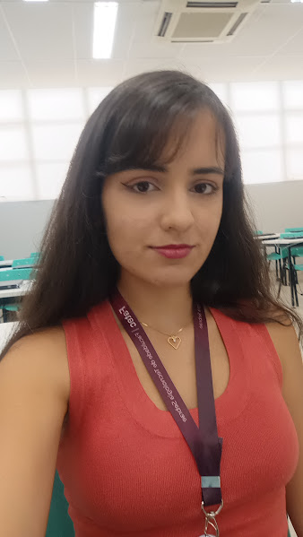

  <a href="./README.md">Português</a> &nbsp;·&nbsp; <b>English</b>

  

 

<table>
  <tr>
    <td width="28%" align="center" valign="middle">
      
    </td>
    <td width="72%" valign="top">
      <h3>Hi, I'm Fernanda.</h3>
      

        Data Science for Business student at <strong>FATEC Sebrae</strong>
        and Internet IT Technician graduate from ETEC Albert Einstein.
      

      

        I enjoy learning by doing and building projects that turn data
        and ideas into useful solutions. I'm currently deepening my studies in
        <strong>Python, SQL and data analysis</strong>.
      

      <picture>
        <source media="(prefers-color-scheme: dark)" srcset="https://github-readme-stats.vercel.app/api?username=nanda-marques&show_icons=true&hide_border=true&theme=transparent&locale=en&custom_title=GitHub%20Activity&title_color=C4A7E7&icon_color=A78BFA&text_color=D8D8E8&rank_icon=github">
        
      </picture>
    </td>
  </tr>
</table>

---

## Tech Stack

<b>LANGUAGES</b> 

   

 

<b>DATA & DEVELOPMENT</b> 

   

  

 

<b>TOOLS</b> 

   

 

---

## Projects

<table>
  <tr>
    <td width="50%" valign="top">
      <b>PUBLIC DATA ANALYSIS</b>
      <h3><a href="https://github.com/nanda-marques/ssp-celulares-subtraidos-2026">Stolen Cell Phones | SSP-SP</a></h3>
      
Dashboard built on public data from the São Paulo Public Security Department: indicators, time series analysis and interactive map.

      
<code>Python</code> <code>Pandas</code> <code>Streamlit</code>

      <a href="https://github.com/nanda-marques/ssp-celulares-subtraidos-2026">Repository</a> &nbsp;·&nbsp;
      <a href="https://ssp-celulares-subtraidos-2026.streamlit.app/">Live app</a>
    </td>
    <td width="50%" valign="top">
      <b>DEMAND FORECASTING · ACADEMIC PROJECT</b>
      <h3><a href="https://github.com/Cosmic-Bubble/projetolavanderia">Laundry Project</a></h3>
      
Demand forecasting and capacity management, developed as a team for Instituto Ninho Social at FATEC Sebrae.

      
<code>Python</code> <code>Statistics</code> <code>Data analysis</code>

      <a href="https://github.com/Cosmic-Bubble/projetolavanderia">Repository</a> &nbsp;·&nbsp;
      <a href="https://projetolavanderia.onrender.com/">Website</a> &nbsp;·&nbsp;
      <a href="https://www.figma.com/design/0cPfF5D0pHMTzKGJX43wMW/Previs%C3%A3o-de-Demanda">Prototype</a>
    </td>
  </tr>
  <tr>
    <td width="50%" valign="top">
      <b>HRTECH · HACKATHON</b>
      <h3><a href="https://github.com/No-Country-simulation/S06-26-AB-Equipe-27">SkillFocus | App BiT</a></h3>
      
MVP of an inclusive employability and diversity platform, built as a team at the Wongola / Black in Tech Hackathon.

      
<code>PHP</code> <code>Laravel</code> <code>Python</code> <code>React</code> <code>FastAPI</code> <code>Gemini</code>

    </td>
    <td width="50%" valign="top">
      <b>3RD PLACE · FATEC INNOVATION CHALLENGE</b>
      <h3><a href="https://github.com/nanda-marques/fic2026-fatec-sebrae-hackeridos">Focinho Amigo</a></h3>
      
Management system and public website for the Focinho Amigo NGO.

      
<code>TypeScript</code> <code>MySQL</code> <code>Supabase</code>

      <a href="https://github.com/nanda-marques/fic2026-fatec-sebrae-hackeridos">Repository</a> &nbsp;·&nbsp;
      <a href="https://fic2026-fatec-sebrae-hackeridos.vercel.app/">Website</a> &nbsp;·&nbsp;
      <a href="https://www.figma.com/design/aGcBilq5WAKQM6nO0ikLXo/Focinho-Amigo---Website?node-id=0-1&t=cbgfM5W9ecKAsQWi-1">Prototype</a>
    </td>
  </tr>
</table>

More projects: <a href="https://github.com/nanda-marques/previsao-tempo-projeto">TempoCerto</a> &nbsp;·&nbsp; <a href="https://github.com/nanda-marques/nossasCores">Nossas Cores</a> &nbsp;·&nbsp; <a href="https://github.com/memoriaviva-org/website-memoria-viva">MemóriaViva</a>

---

## Education

**FATEC Sebrae** 
Technology in Data Science for Business 
2026–2028 &nbsp;·&nbsp; in progress

**ETEC Albert Einstein** 
Internet IT Technician 
2023–2025 &nbsp;·&nbsp; completed

  

