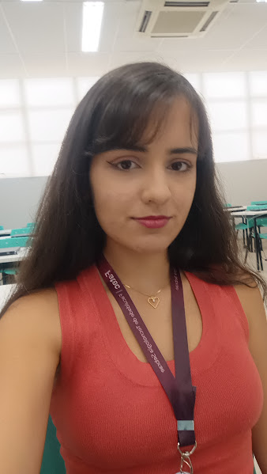

  <b>Português</b> &nbsp;·&nbsp; <a href="./README.en.md">English</a>

  

 

<table>
  <tr>
    <td width="28%" align="center" valign="middle">
      
    </td>
    <td width="72%" valign="top">
      <h3>Olá, eu sou a Fernanda.</h3>
      

        Estudante de <strong>Ciência de Dados para Negócios</strong> na FATEC Sebrae
        e técnica em Informática para Internet pela ETEC Albert Einstein.
      

      

        Gosto de aprender na prática e de construir projetos que transformam dados
        e ideias em soluções úteis. No momento, aprofundo meus estudos em
        <strong>Python, SQL e análise de dados</strong>.
      

      <picture>
        <source media="(prefers-color-scheme: dark)" srcset="https://github-readme-stats.vercel.app/api?username=nanda-marques&show_icons=true&hide_border=true&theme=transparent&locale=pt-br&custom_title=Atividade%20no%20GitHub&title_color=C4A7E7&icon_color=A78BFA&text_color=D8D8E8&rank_icon=github">
        
      </picture>
    </td>
  </tr>
</table>

---

## Tecnologias

<b>LINGUAGENS</b> 

   

 

<b>DADOS E DESENVOLVIMENTO</b> 

    

  

 

<b>FERRAMENTAS</b> 

   

 

---

## Projetos

<table>
  <tr>
    <td width="50%" valign="top">
      <b>ANÁLISE DE DADOS PÚBLICOS</b>
      <h3><a href="https://github.com/nanda-marques/ssp-celulares-subtraidos-2026">Celulares Subtraídos | SSP-SP</a></h3>
      
Dashboard com dados da Secretaria de Segurança Pública de São Paulo: indicadores, análise temporal e mapa interativo.

      
<code>Python</code> <code>Pandas</code> <code>Streamlit</code>

      <a href="https://github.com/nanda-marques/ssp-celulares-subtraidos-2026">Repositório</a> &nbsp;·&nbsp;
      <a href="https://ssp-celulares-subtraidos-2026.streamlit.app/">Aplicação</a>
    </td>
    <td width="50%" valign="top">
      <b>PREVISÃO DE DEMANDA · PROJETO ACADÊMICO</b>
      <h3><a href="https://github.com/Cosmic-Bubble/projetolavanderia">Projeto Lavanderia</a></h3>
      
Previsão de demanda e gestão de capacidade, desenvolvidas em equipe para o Instituto Ninho Social na FATEC Sebrae.

      
<code>Python</code> <code>Estatística</code> <code>Análise de dados</code>

      <a href="https://github.com/Cosmic-Bubble/projetolavanderia">Repositório</a> &nbsp;·&nbsp;
      <a href="https://projetolavanderia.onrender.com/">Website</a> &nbsp;·&nbsp;
      <a href="https://www.figma.com/design/0cPfF5D0pHMTzKGJX43wMW/Previs%C3%A3o-de-Demanda">Protótipo</a>
    </td>
  </tr>
  <tr>
    <td width="50%" valign="top">
      <b>HRTECH · HACKATHON</b>
      <h3><a href="https://github.com/No-Country-simulation/S06-26-AB-Equipe-27">SkillFocus | App BiT</a></h3>
      
MVP de uma plataforma de empregabilidade inclusiva e diversidade, criado em equipe no Hackathon Wongola / Black in Tech.

      
<code>PHP</code> <code>Laravel</code> <code>Python</code> <code>React</code> <code>FastAPI</code> <code>Gemini</code>

    </td>
    <td width="50%" valign="top">
      <b>3º LUGAR · FATEC INNOVATION CHALLENGE</b>
      <h3><a href="https://github.com/nanda-marques/fic2026-fatec-sebrae-hackeridos">Focinho Amigo</a></h3>
      
Sistema de gerenciamento e site público para a ONG Focinho Amigo.

      
<code>TypeScript</code> <code>MySQL</code> <code>Supabase</code>

      <a href="https://github.com/nanda-marques/fic2026-fatec-sebrae-hackeridos">Repositório</a> &nbsp;·&nbsp;
      <a href="https://fic2026-fatec-sebrae-hackeridos.vercel.app/">Website</a> &nbsp;·&nbsp;
      <a href="https://www.figma.com/design/aGcBilq5WAKQM6nO0ikLXo/Focinho-Amigo---Website?node-id=0-1&t=cbgfM5W9ecKAsQWi-1">Protótipo</a>
    </td>
  </tr>
</table>

Mais projetos: <a href="https://github.com/nanda-marques/previsao-tempo-projeto">TempoCerto</a> &nbsp;·&nbsp; <a href="https://github.com/nanda-marques/nossasCores">Nossas Cores</a> &nbsp;·&nbsp; <a href="https://github.com/memoriaviva-org/website-memoria-viva">MemóriaViva</a>

---

## Formação

**FATEC Sebrae** 
Tecnologia em Ciência de Dados para Negócios 
2026–2028 &nbsp;·&nbsp; em andamento

**ETEC Albert Einstein** 
Técnico em Informática para Internet 
2023–2025 &nbsp;·&nbsp; concluído

  

